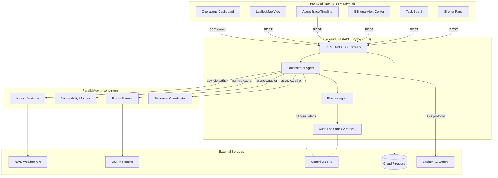

# GridGuardian

**Autonomous multi-agent disaster response platform powered by Google ADK, Gemini 3.1 Pro, and real-time data.**

GridGuardian orchestrates 7 specialized AI agents in parallel to detect hazards, assess vulnerabilities, plan routes, coordinate resources, and produce audited response plans — all streamed live to an operations dashboard.

> **Live Demo:** https://frontend-747675777203.us-central1.run.app

---

## Architecture



## Live Data Sources

| Tool | Source | API Key Required |
|------|--------|:---:|
| Weather | [NWS Weather.gov](https://api.weather.gov) (Tampa, FL coords) | No |
| Hazard Zones | [NWS Active Alerts](https://api.weather.gov/alerts/active) (Florida) | No |
| Routing | [OSRM](https://router.project-osrm.org) (Tampa landmarks) | No |
| News | NWS Alerts + Google News RSS | No |
| LLM (Audit + Alerts) | [Gemini 3.1 Pro](https://ai.google.dev/) | Yes |
| Database | [Cloud Firestore](https://firebase.google.com/products/firestore) | GCP credentials |
| Shelter Analysis | A2A Agent on Cloud Run | No (internal) |

## Tech Stack

| Layer | Technology | Version |
|-------|-----------|---------|
| Frontend | Next.js, React, Tailwind CSS, Leaflet | 14.2 / 18.3 / 3.4 |
| Backend | FastAPI, Python, Pydantic | 0.135 / 3.13 / 2.12 |
| AI | Gemini 3.1 Pro via google-genai | Latest |
| Agents | Google ADK patterns (ParallelAgent, LoopAgent) | 1.28 |
| Database | Cloud Firestore (Native mode) | us-central1 |
| Protocol | A2A (Agent-to-Agent) | 1.0 |
| Security | slowapi rate limiting, CORS restriction, input validation | Production |
| Infrastructure | Docker, Cloud Run, Artifact Registry | Python 3.13 / Node 22 |

## Live Deployment

| Service | URL |
|---------|-----|
| **Frontend** | https://frontend-747675777203.us-central1.run.app |
| **Backend API** | https://backend-747675777203.us-central1.run.app |
| **Shelter Agent (A2A)** | https://shelter-agent-747675777203.us-central1.run.app |

GCP Project: `gridguardian-491621` | Region: `us-central1`

## Quick Start

### Docker (Recommended)

```bash
git clone https://github.com/SaiBalusu-usf/Grid-Guardian.git
cd Grid-Guardian
cp .env.example .env
# Edit .env with your GEMINI_API_KEY

docker compose up --build
# Frontend: http://localhost:3000
# Backend:  http://localhost:8000
# Shelter:  http://localhost:8001
```

### Manual

```bash
# Terminal 1: Shelter Agent
cd backend/a2a_shelter_agent
pip install -r requirements.txt
uvicorn server:app --port 8001

# Terminal 2: Backend
pip install -r backend/requirements.txt
uvicorn backend.main:app --port 8000

# Terminal 3: Frontend
cd frontend && npm install && npm run dev
```

## API Endpoints

| Method | Path | Description | Rate Limit |
|--------|------|-------------|:---:|
| `GET` | `/health` | Health check with version info | — |
| `POST` | `/api/incidents/simulate` | Trigger disaster simulation | 20/min |
| `GET` | `/api/incidents` | List all incidents | — |
| `GET` | `/api/incidents/{id}` | Get incident details | — |
| `GET` | `/api/incidents/{id}/trace` | Get agent trace events | — |
| `POST` | `/api/incidents/{id}/cancel` | Cancel active incident | 10/min |
| `GET` | `/api/tasks` | List tasks (filterable by incident) | — |
| `PATCH` | `/api/tasks/{id}` | Update task status | — |
| `GET` | `/api/alerts` | List alerts (filterable by incident) | — |
| `POST` | `/api/alerts/{id}/ack` | Acknowledge alert | — |
| `GET` | `/api/shelters` | List all shelters | — |
| `GET` | `/api/dashboard` | Aggregated dashboard stats | — |
| `GET` | `/api/stream` | SSE real-time event stream | — |
| `POST` | `/api/clear` | Clear all simulation data | 5/hr |

See [API.md](API.md) for full request/response schemas.

## Agent Workflow

1. **Trigger** — Incident created from simulation or alert
2. **Parallel Analysis** — 4 agents run concurrently (90s timeout):
   - **Hazard Watcher** — NWS weather + hazard zones + news feeds
   - **Vulnerability Mapper** — Scores hospitals, shelters, schools, mobile homes
   - **Route Planner** — OSRM safe routes, closures, travel risk
   - **Resource Coordinator** — Crews, generators, medical teams, supplies
3. **Planning** — Merges all outputs into unified action plan
4. **Audit Loop** (max 2 iterations) — Gemini 3.1 Pro + rule-based critique:
   - Missing evidence, unsafe assumptions, vulnerable populations, vague alerts, route contradictions
   - If fails → apply corrections → re-audit
5. **A2A Shelter Call** — External shelter specialist analyzes capacity + accessibility
6. **Public Alerts** — Gemini generates bilingual (EN/ES) contextual alerts
7. **Execution** — Creates tasks + alerts in Firestore, broadcasts via SSE

## Demo Scenarios

| Scenario | Description |
|----------|-------------|
| **Hurricane Watch** | Hurricane near USF campus and Tampa General Hospital. 85mph winds, storm surge warning, flash floods across Hillsborough County. |
| **Grid Outage** | Power grid failure across downtown Tampa and Davis Islands. TECO substations offline, hospital generators failing. 15,000+ without power. |
| **Multi-Zone Emergency** | Storm surge in South Tampa, structural collapse in Ybor City, hazmat near Port Tampa. 5 shelters activating, 12,000 affected. |

## Security

- **Rate limiting** — slowapi (20/min simulate, 5/hr clear, 10/min cancel)
- **CORS** — Restricted to frontend origin via `ALLOWED_ORIGINS` env var
- **Input validation** — Scenario 1-2000 chars, task status regex-validated, model Literal types
- **Credentials** — `.env` gitignored, API keys via Cloud Run env vars
- **No authentication** (hackathon MVP) — add OAuth/API keys for production

## Environment Variables

| Variable | Default | Description |
|----------|---------|-------------|
| `GOOGLE_CLOUD_PROJECT` | `gridguardian-491621` | GCP project ID |
| `GEMINI_API_KEY` | (empty) | Gemini API key for LLM agents |
| `SHELTER_AGENT_URL` | `http://localhost:8001` | Shelter A2A agent endpoint |
| `USE_MOCK` | `true` | `false` for real-time live data |
| `ALLOWED_ORIGINS` | `*` | CORS origins (comma-separated) |
| `FIRESTORE_EMULATOR_HOST` | (empty) | Firestore emulator (empty = real) |
| `SSE_ENABLED` | `true` | Enable SSE streaming |
| `LOG_LEVEL` | `INFO` | Logging verbosity |

## Testing

```bash
# All 55 backend tests (0 warnings)
pytest tests/backend/ -v -W error::DeprecationWarning

# Specific suites
pytest tests/backend/test_tools.py -v       # Tool unit tests
pytest tests/backend/test_audit_loop.py -v   # Audit loop tests
pytest tests/backend/test_a2a_handshake.py -v # A2A protocol tests
```

All tests run in mock mode — no external services needed.

## Project Structure

```
Grid-Guardian/
├── backend/
│   ├── agents/                  # 7 specialist agents
│   │   ├── orchestrator.py      # Main workflow engine
│   │   ├── hazard_watcher.py    # NWS weather + hazard analysis
│   │   ├── vulnerability_mapper.py # Population vulnerability scoring
│   │   ├── route_planner.py     # OSRM safe route planning
│   │   ├── resource_coordinator.py # Resource allocation
│   │   ├── planner.py           # Merge outputs → action plan
│   │   ├── audit.py             # Gemini + rule-based plan critique
│   │   └── public_alert.py      # Gemini bilingual alert drafting
│   ├── tools/                   # 6 MCP-style tool wrappers
│   │   ├── weather_tool.py      # NWS Weather.gov API
│   │   ├── hazard_tool.py       # NWS Active Alerts API
│   │   ├── routing_tool.py      # OSRM routing API
│   │   ├── news_tool.py         # NWS + Google News RSS
│   │   ├── firestore_tool.py    # Firestore with in-memory fallback
│   │   └── notification_tool.py # Notification mock
│   ├── models/                  # Pydantic models with validation
│   ├── services/
│   │   ├── firestore_service.py # High-level Firestore operations
│   │   ├── streaming.py         # SSE with heartbeat
│   │   └── gemini_client.py     # Gemini 3.1 Pro client
│   ├── workflows/
│   │   └── incident_workflow.py # Background task runner
│   ├── a2a_shelter_agent/       # Separate A2A service
│   ├── main.py                  # FastAPI app
│   └── config.py                # Environment config
├── frontend/
│   └── src/
│       ├── app/                 # 8 Next.js pages
│       ├── components/          # 11 React components
│       └── lib/                 # API client, hooks, types, utils
├── tests/                       # 55 tests (0 warnings)
├── docs/                        # README, API, architecture, demo script
├── infra/                       # Cloud Run deploy, Firestore rules
├── docker-compose.yml
└── .env.example
```

## Credits

Built for the **Google ADK Hackathon** by [Sai Balusu](https://github.com/SaiBalusu-usf).

Powered by:
- [Google Gemini 3.1 Pro](https://ai.google.dev/) — LLM reasoning
- [Google Cloud Firestore](https://firebase.google.com/products/firestore) — Real-time database
- [Google Cloud Run](https://cloud.google.com/run) — Serverless deployment
- [NWS Weather API](https://api.weather.gov) — Real-time weather & alerts
- [OSRM](https://project-osrm.org/) — Open-source routing
- [FastAPI](https://fastapi.tiangolo.com/) — Backend framework
- [Next.js](https://nextjs.org/) — Frontend framework
- [Leaflet](https://leafletjs.com/) — Interactive maps
