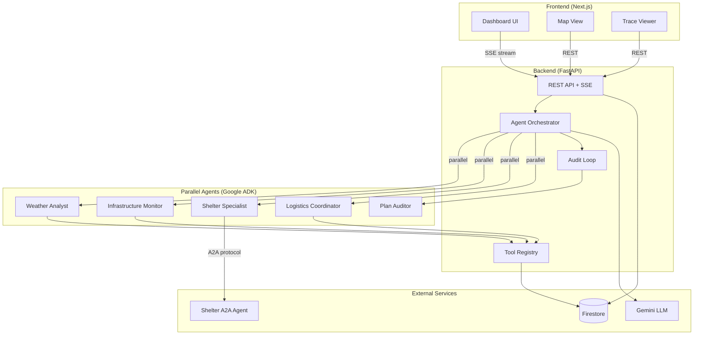

# GridGuardian

**Multi-agent disaster response coordination system powered by Google ADK and Gemini.**

GridGuardian orchestrates specialized AI agents in parallel to analyze disasters, assess infrastructure, coordinate shelters, and produce audited response plans -- all streamed to a real-time dashboard.

---

## Architecture



## Tech Stack

| Layer | Technology | Purpose |
|-------|-----------|---------|
| Frontend | Next.js 14, React 18, Tailwind CSS | Real-time dashboard with SSE |
| Backend | FastAPI, Python 3.12 | REST API, SSE streaming, agent orchestration |
| AI Framework | Google ADK (Agent Development Kit) | Multi-agent orchestration |
| LLM | Gemini | Agent reasoning and plan generation |
| Database | Cloud Firestore | Incidents, traces, alerts, tasks |
| Agent Protocol | A2A (Agent-to-Agent) | Inter-agent communication |
| Maps | Leaflet / React Leaflet | Hazard and shelter visualization |
| Infrastructure | Docker, Cloud Run | Containerized deployment |

## Prerequisites

- **Python 3.12+** with pip
- **Node.js 18+** with npm
- **Docker** (optional, for containerized development)
- **Google Cloud account** (optional, for Firestore and Cloud Run deployment)
- **Gemini API key** (optional, for LLM-powered agents; mock mode works without it)

## Quick Start

```bash
# 1. Clone and install
git clone https://github.com/your-org/grid-guardian.git
cd grid-guardian
cp .env.example .env

# 2. Install dependencies
pip install -r backend/requirements.txt
cd frontend && npm install && cd ..

# 3. Run everything
bash scripts/run-local.sh
```

Open [http://localhost:3000](http://localhost:3000) to see the dashboard.

## Local Development

### Backend (port 8000)

```bash
cd backend
pip install -r requirements.txt
uvicorn backend.main:app --reload --port 8000
```

### Shelter Agent (port 8001)

```bash
cd backend/a2a_shelter_agent
uvicorn main:app --reload --port 8001
```

### Frontend (port 3000)

```bash
cd frontend
npm install
npm run dev
```

### Run All Tests

```bash
# Backend tests
pytest tests/backend/ -v

# Frontend tests
cd frontend && npx jest --passWithNoTests
```

## Docker Compose

```bash
# Start all services
docker compose up --build

# Services:
#   Frontend:      http://localhost:3000
#   Backend API:   http://localhost:8000
#   Shelter Agent: http://localhost:8001
```

## Cloud Run Deployment

```bash
export GOOGLE_CLOUD_PROJECT=your-project-id
export GEMINI_API_KEY=your-key
bash infra/cloud-run-deploy.sh
```

The deployment script will:
1. Enable required Google Cloud APIs
2. Build and push Docker images to Artifact Registry
3. Deploy all three services to Cloud Run
4. Output public URLs

## Project Structure

```
grid-guardian/
├── backend/
│   ├── a2a_shelter_agent/      # A2A shelter specialist agent
│   │   ├── agent.py            # Shelter analysis logic
│   │   ├── agent_card.py       # A2A agent card & validation
│   │   └── agent_executor.py   # A2A task executor
│   ├── agents/                 # Google ADK agent definitions
│   ├── models/                 # Pydantic data models
│   ├── services/               # Firestore service layer
│   ├── tools/                  # Agent tool implementations
│   ├── workflows/              # Orchestration & audit loop
│   ├── config.py               # Environment configuration
│   ├── main.py                 # FastAPI application
│   ├── requirements.txt        # Python dependencies
│   └── Dockerfile
├── frontend/
│   ├── src/
│   │   ├── app/
│   │   │   ├── dashboard/      # Main dashboard page
│   │   │   ├── alerts/         # Alert management
│   │   │   ├── map/            # Hazard/shelter map
│   │   │   ├── shelters/       # Shelter details
│   │   │   ├── tasks/          # Task management
│   │   │   ├── trace/          # Agent trace viewer
│   │   │   └── settings/       # Configuration
│   │   ├── components/         # Shared React components
│   │   └── lib/                # Utilities & API client
│   ├── package.json
│   └── tsconfig.json
├── infra/
│   ├── cloud-run-deploy.sh     # Cloud Run deployment script
│   ├── firestore.rules         # Firestore security rules
│   └── firestore-seed.json     # Seed data for development
├── scripts/
│   ├── run-local.sh            # Start all services locally
│   └── seed-firestore.sh       # Seed Firestore with test data
├── tests/
│   ├── backend/
│   │   ├── conftest.py         # Shared fixtures
│   │   ├── test_tools.py       # Tool unit tests
│   │   ├── test_audit_loop.py  # Audit loop tests
│   │   ├── test_firestore.py   # Firestore service tests
│   │   ├── test_incident_simulation.py  # Integration tests
│   │   └── test_a2a_handshake.py        # A2A protocol tests
│   └── frontend/
│       └── dashboard.test.tsx  # Dashboard component tests
├── docs/
│   ├── README.md               # This file
│   ├── API.md                  # API documentation
│   ├── architecture.md         # Architecture deep-dive
│   └── demo-script.md          # 2-minute demo script
├── docker-compose.yml
├── .env.example
└── .gitignore
```

## API Summary

| Method | Path | Description |
|--------|------|-------------|
| `GET` | `/health` | Health check |
| `POST` | `/api/incidents/simulate` | Trigger incident simulation |
| `GET` | `/api/incidents` | List all incidents |
| `GET` | `/api/incidents/{id}` | Get incident details |
| `GET` | `/api/incidents/{id}/trace` | Get agent trace events |
| `GET` | `/api/incidents/{id}/stream` | SSE event stream |
| `GET` | `/api/dashboard` | Aggregated dashboard data |
| `GET` | `/api/agents` | List agent statuses |
| `GET` | `/api/alerts` | List alerts |
| `POST` | `/api/alerts/{id}/acknowledge` | Acknowledge alert |
| `GET` | `/api/shelters` | List shelters |
| `GET` | `/a2a/agent-card` | Shelter agent A2A card |
| `POST` | `/a2a/execute` | Execute A2A task |

See [docs/API.md](API.md) for full request/response schemas.

## Demo Scenarios

| Scenario | Description | Key Features Shown |
|----------|-------------|-------------------|
| **Hurricane** | Category 3 hurricane approaching Tampa | Parallel agents, shelter overflow, audit loop |
| **Earthquake** | 6.2 magnitude earthquake | Structural assessment, route planning |
| **Power Outage** | Ice storm causing grid failure | Infrastructure monitoring, generator deployment |
| **Flood** | Flash flooding in urban area | Hazard mapping, evacuation routing |

## Environment Variables

| Variable | Default | Description |
|----------|---------|-------------|
| `GOOGLE_CLOUD_PROJECT` | `gridguardian-demo` | Google Cloud project ID |
| `FIRESTORE_EMULATOR_HOST` | (empty) | Firestore emulator host |
| `GEMINI_API_KEY` | (empty) | Gemini API key for LLM agents |
| `SHELTER_AGENT_URL` | `http://localhost:8001` | Shelter agent A2A endpoint |
| `USE_MOCK` | `true` | Use mock data instead of real APIs |
| `LOG_LEVEL` | `INFO` | Logging verbosity |

## Testing

```bash
# Run all backend tests
pytest tests/backend/ -v

# Run specific test file
pytest tests/backend/test_tools.py -v

# Run with coverage
pytest tests/backend/ --cov=backend --cov-report=term-missing

# Frontend tests
cd frontend && npx jest --passWithNoTests
```

All backend tests run in mock mode by default -- no external services, API keys, or network access required.

## Credits

Built for the Google ADK Hackathon. Powered by:

- [Google Agent Development Kit (ADK)](https://google.github.io/adk-docs/)
- [Gemini](https://ai.google.dev/)
- [Cloud Firestore](https://firebase.google.com/products/firestore)
- [FastAPI](https://fastapi.tiangolo.com/)
- [Next.js](https://nextjs.org/)
- [Leaflet](https://leafletjs.com/)
