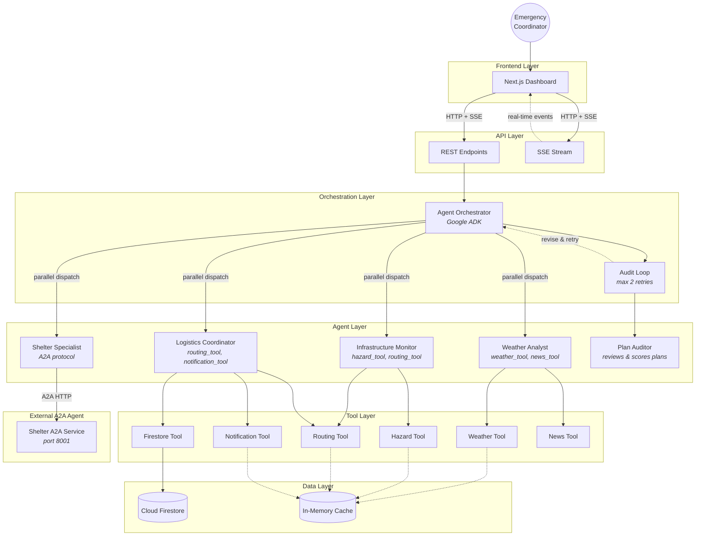
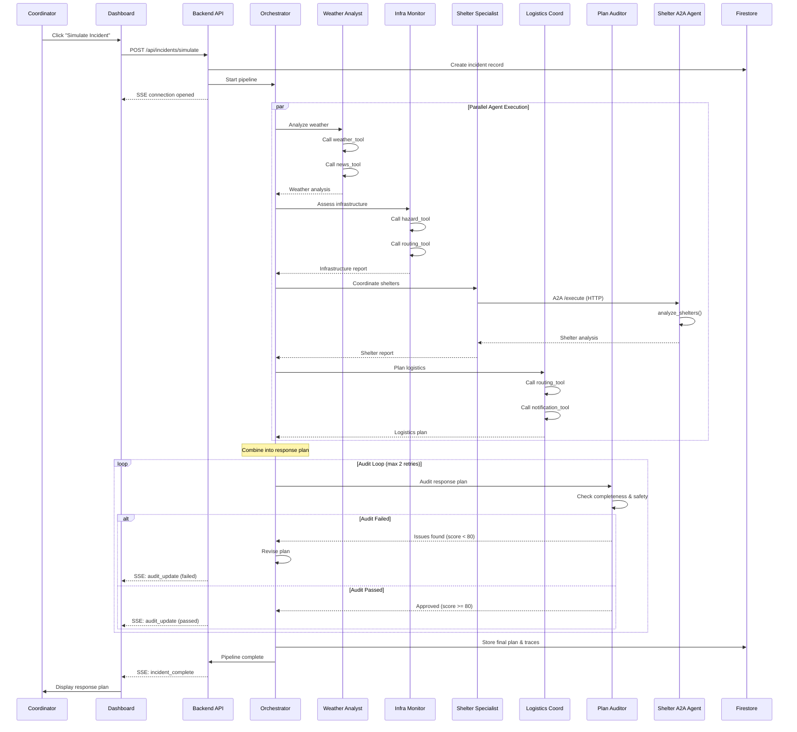

# GridGuardian Architecture

## System Overview

GridGuardian is a multi-agent disaster response system that coordinates specialized AI agents to produce comprehensive, audited response plans in real time. The system is built on three pillars:

1. **Parallel agent execution** -- Multiple specialist agents analyze different aspects of a disaster simultaneously
2. **Audit-loop quality control** -- An auditor agent reviews plans and triggers revisions until quality thresholds are met
3. **A2A inter-agent communication** -- The shelter agent runs as an independent service using the Agent-to-Agent protocol

## Agent Topology



## Incident Workflow Sequence



## Data Flow

### 1. Incident Creation

When a coordinator triggers a simulation:
- The API creates an incident document in Firestore with status `active`
- An SSE connection is opened for real-time updates
- The orchestrator dispatches all four specialist agents in parallel

### 2. Parallel Agent Execution

Each agent runs independently and concurrently:
- **Weather Analyst** calls `weather_tool` and `news_tool` to gather conditions and context
- **Infrastructure Monitor** calls `hazard_tool` and `routing_tool` to identify hazards and viable routes
- **Shelter Specialist** makes an A2A HTTP call to the external shelter agent service, which analyzes capacity, accessibility, and supplies
- **Logistics Coordinator** calls `routing_tool` and `notification_tool` to plan evacuation and resource deployment

Each agent's progress is streamed to the frontend via SSE events.

### 3. Plan Assembly & Audit

Once all agents complete:
- The orchestrator combines their outputs into a unified response plan
- The plan auditor reviews the plan for completeness, safety gaps, and resource allocation issues
- If the audit fails (score < 80), the plan is revised and re-audited
- Maximum 2 retries before the plan is accepted with warnings

### 4. Storage & Presentation

The final plan, all trace events, and any generated alerts are persisted to Firestore. The dashboard displays the complete response plan with real-time status updates.

## Firestore Collection Schemas

### incidents

```
incidents/{incident_id}
├── incident_id: string
├── type: string (hurricane | earthquake | flood | wildfire | power_outage | winter_storm)
├── severity: string (low | medium | high | critical)
├── status: string (active | resolved | archived)
├── location: string
├── description: string
├── affected_population: number
├── agents_dispatched: string[]
├── response_plan: object | null
├── audit_result: object | null
├── created_at: timestamp
└── updated_at: timestamp
```

### agent_runs

```
agent_runs/{run_id}
├── run_id: string
├── incident_id: string
├── agent: string
├── status: string (running | completed | failed)
├── duration_ms: number
├── input_summary: string
├── output_summary: string
└── timestamp: timestamp
```

### traces

```
traces/{trace_id}
├── trace_id: string
├── incident_id: string
├── event_type: string
├── agent: string
├── message: string
├── data: object
└── timestamp: timestamp
```

### shelters

```
shelters/{shelter_id}
├── shelter_id: string
├── name: string
├── address: string
├── capacity: number
├── occupancy: number
├── accessibility: string (standard | wheelchair | full_ada)
├── supplies: object
├── backup_power: boolean
├── medical_staff: boolean
├── pet_friendly: boolean
├── coordinates: { lat: number, lng: number }
├── status: string
└── last_updated: timestamp
```

### alerts

```
alerts/{alert_id}
├── alert_id: string
├── incident_id: string
├── severity: string (info | warning | critical)
├── title: string
├── message: string
├── acknowledged: boolean
├── acknowledged_at: timestamp | null
├── acknowledged_by: string | null
└── created_at: timestamp
```

### tasks

```
tasks/{task_id}
├── task_id: string
├── incident_id: string
├── title: string
├── assigned_to: string
├── priority: string (low | medium | high | critical)
├── status: string (pending | in_progress | completed | cancelled)
├── created_at: timestamp
└── updated_at: timestamp
```

### config

```
config/{doc_id}
├── version: string
├── default_region: string
├── audit_max_retries: number
├── sse_enabled: boolean
├── mock_mode: boolean
├── agent_timeout_seconds: number
├── supported_scenarios: string[]
└── alert_channels: string[]
```

### resources

```
resources/{resource_id}
├── resource_id: string
├── type: string
├── name: string
├── status: string (available | deployed | in_transit | maintenance)
├── location: string
├── assigned_to: string | null
├── quantity: number
└── last_updated: timestamp
```

## A2A Protocol

The Agent-to-Agent (A2A) protocol enables inter-agent communication over HTTP. In GridGuardian, the Shelter Specialist agent runs as a separate microservice with its own FastAPI application.

### How it works:

1. **Discovery**: The orchestrator calls `GET /a2a/agent-card` to discover the agent's capabilities, input/output schemas, and endpoint URL.

2. **Execution**: The orchestrator sends a task to `POST /a2a/execute` with a standardized envelope:
   ```json
   {
     "task_id": "unique-id",
     "message": {
       "role": "user",
       "content": { ... query parameters ... }
     }
   }
   ```

3. **Result**: The agent processes the task and returns a result with status, output data, and metadata.

4. **Retrieval**: Previous task results can be fetched via `GET /a2a/tasks/{task_id}`.

### Why A2A?

- **Decoupling**: The shelter agent can be developed, tested, and deployed independently
- **Scalability**: Each agent scales independently based on load
- **Interoperability**: Any system speaking A2A can integrate with the shelter agent
- **Resilience**: If the shelter agent goes down, other agents continue working

## Tool Descriptions

| Tool | Used By | Description |
|------|---------|-------------|
| `weather_tool` | Weather Analyst | Fetches current conditions, forecasts, alerts, and severe weather data |
| `news_tool` | Weather Analyst | Aggregates relevant news articles for situational awareness |
| `hazard_tool` | Infrastructure Monitor | Identifies hazards (flooding, downed lines, structural damage) in the area |
| `routing_tool` | Infrastructure Monitor, Logistics | Computes evacuation routes considering road closures and hazards |
| `notification_tool` | Logistics Coordinator | Sends alerts to dashboard, email, and SMS channels |
| `firestore_tool` | Logistics Coordinator | Reads/writes operational data to Firestore |

In mock mode (default), all tools return deterministic data. In production, they connect to real weather APIs, mapping services, and notification providers.

## Design Decisions and Trade-offs

### Parallel execution over sequential

**Decision**: All specialist agents run concurrently, not sequentially.
**Why**: Disaster response is time-critical. Running agents in parallel reduces end-to-end latency from ~12s (sequential) to ~3s (parallel, bounded by the slowest agent).
**Trade-off**: Agents cannot easily depend on each other's output during initial analysis. The orchestrator handles cross-agent coordination after all agents complete.

### Audit loop with bounded retries

**Decision**: The plan auditor can trigger up to 2 revisions before accepting the plan.
**Why**: Ensures response plans meet minimum quality standards (capacity coverage, resource allocation, safety checks) without infinite loops.
**Trade-off**: In rare cases, a plan may be accepted with known issues if retries are exhausted. These are surfaced as warnings in the dashboard.

### A2A for shelter agent, ADK for others

**Decision**: The shelter agent uses the A2A protocol (HTTP-based inter-agent communication) while other agents use Google ADK's built-in orchestration.
**Why**: Demonstrates both integration patterns. A2A shows how GridGuardian can communicate with external agent services. ADK shows tight integration with Google's agent framework.
**Trade-off**: A2A adds network latency (~50ms) compared to in-process ADK calls. Worth it for the decoupling and independent scalability benefits.

### In-memory fallback for Firestore

**Decision**: When Firestore credentials are unavailable, the system falls back to in-memory storage.
**Why**: Enables local development and testing without any cloud setup. Mock mode with in-memory storage means zero external dependencies.
**Trade-off**: In-memory data is lost on restart. This is acceptable for development and demos; production always uses real Firestore.

### SSE over WebSockets

**Decision**: Server-Sent Events for real-time updates, not WebSockets.
**Why**: SSE is simpler (one-way, built on HTTP), works through proxies and load balancers, and auto-reconnects. The dashboard only needs server-to-client updates; client-to-server communication uses REST.
**Trade-off**: No bidirectional communication. If we needed client-to-server streaming (e.g., live chat), WebSockets would be necessary.

### Mock mode as default

**Decision**: `USE_MOCK=true` by default, all tools return deterministic data.
**Why**: Enables instant setup, reliable testing, and demo-ability without API keys or external services.
**Trade-off**: Mock data is static and cannot simulate edge cases or unexpected API responses. Integration tests with real APIs should be run separately before production deployment.
